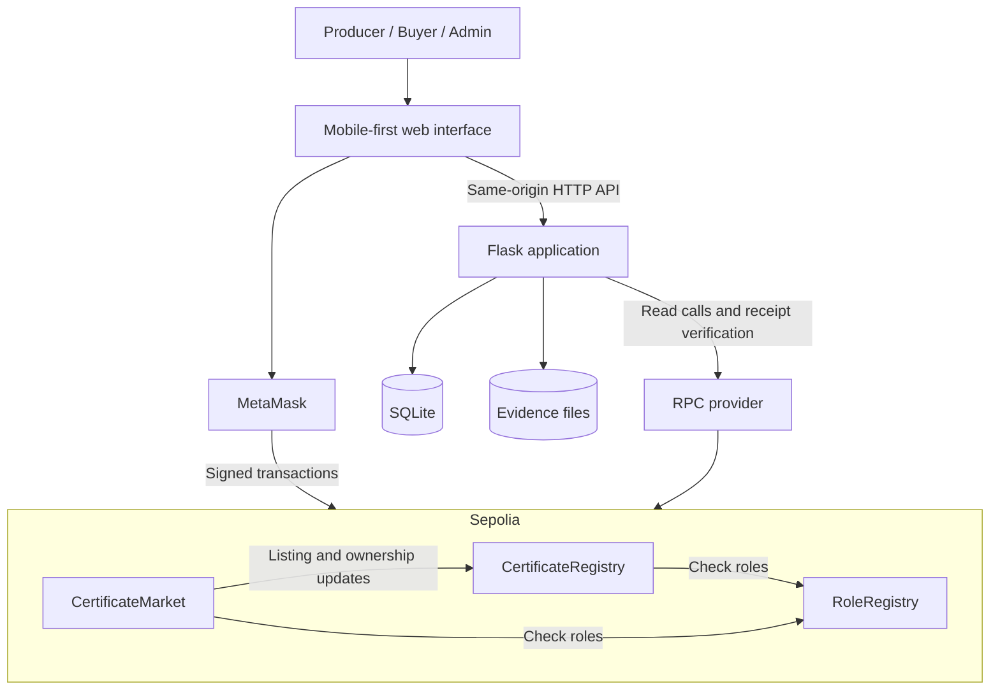
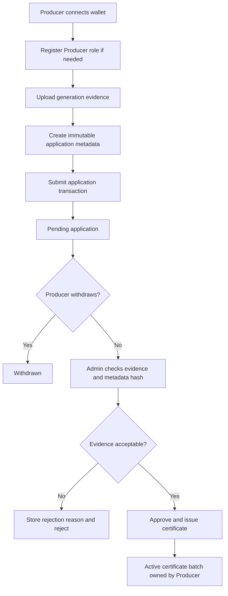
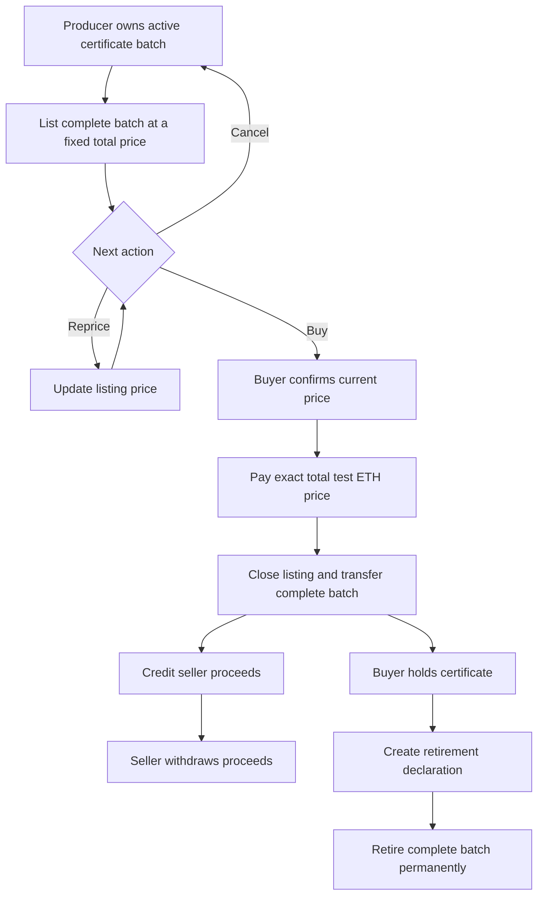
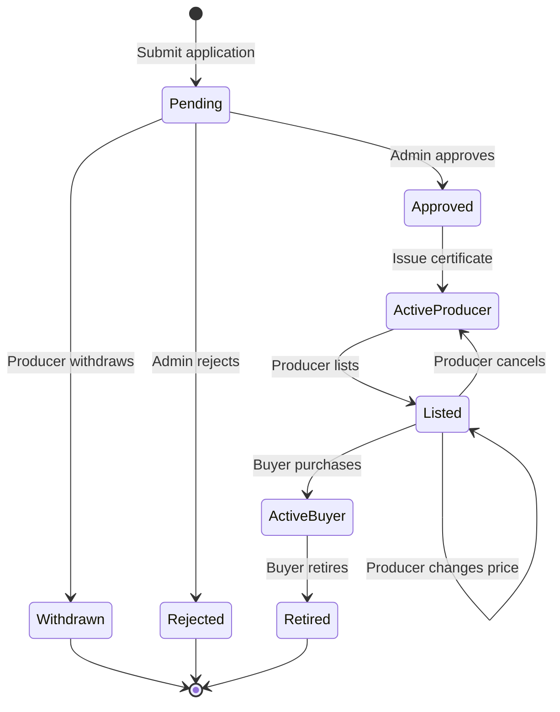

# Architecture and Workflows

## System Architecture



HTML, CSS and JavaScript provide the interface. Flask serves pages, stores evidence and metadata, authenticates signed wallet sessions, and reads contract state. MetaMask signs all user transactions. The server has no signing key and cannot approve applications, transfer certificates or spend user funds.

The contracts are the authoritative source for roles, application status, ownership, listings, prices, balances and retirement. SQLite stores supporting content and verified transaction references. A database record cannot override a contract result.

## Technology Choices

| Layer | Technology | Purpose |
|---|---|---|
| Contracts | Solidity 0.8.x and Remix | Contract development, compilation and deployment. |
| Browser | HTML, CSS, JavaScript and ethers.js | Responsive pages, ABI calls, wallet interaction and transaction states. |
| Wallet | MetaMask | Address connection, message signatures and transaction approval. |
| Server | Python, Flask and Jinja | Page rendering, API routes and application services. |
| Chain reads | web3.py and eth-account | Contract reads, receipt decoding and message signature recovery. |
| Storage | SQLite through sqlite3; local files on persistent disk | Sessions, immutable metadata and generation evidence. |
| Network | Sepolia | Demonstration transactions using test ETH. |
| Hosting | Render with persistent storage | Public Flask application and durable local data. |

Pin compatible dependency versions during implementation. A single server process and bounded chain reads are sufficient for the coursework dataset.

## Issuance Flow



The Admin must compare the metadata hash and application fields with the on-chain record. Missing or inconsistent evidence blocks approval in the interface. The contract enforces permissions and state transitions; the reviewer's judgement supplies the evidence assessment.

## Trading and Retirement Flow



Closing the listing, transferring ownership and crediting the seller form one atomic transaction. Withdrawal is a separate seller action; a payment recipient cannot interrupt a purchase by rejecting an immediate transfer.

## State Transitions



This diagram combines the application and certificate lifecycles. In storage, application status and certificate status use separate enums; listing is a boolean state. Retirement retains the certificate record rather than deleting it.

## Purchase Sequence

```mermaid
sequenceDiagram
    actor Buyer
    participant UI as Browser
    participant API as Flask API
    participant Wallet as MetaMask
    participant Market as CertificateMarket
    participant Registry as CertificateRegistry
    Buyer->>UI: Open certificate
    UI->>API: Read certificate, metadata and listing
    API-->>UI: Current state and snapshot block
    Buyer->>UI: Confirm purchase
    UI->>Wallet: buyCertificate(id, expectedPrice), value=price
    Wallet->>Market: Signed transaction
    Market->>Market: Check Buyer, listing and exact price
    Market->>Registry: transferOnSale(id, seller, buyer)
    Registry-->>Market: Ownership updated; listed=false
    Market->>Market: Close listing; credit seller; emit event
    Wallet-->>UI: Transaction hash
    UI->>API: Verify transaction hash
    API->>Market: Read receipt, input and events
    API-->>UI: Verified result or pending state
    UI-->>Buyer: Refresh ownership and show receipt link
```

## Failure and Recovery

- Rejected wallet requests leave the current business state unchanged.
- A transaction hash means submission, not success. The interface waits for a receipt.
- A reverted transaction does not produce a successful business update.
- If API verification fails after an on-chain success, the interface preserves the hash and offers verification again. It must not prompt a duplicate purchase.
- RPC failures produce an unavailable state. Previously loaded information must not be presented as newly verified data.
- On refresh, the application reads current contract state and reconciles any saved transaction hash.
- Account or network changes clear the session and cached role-dependent data before further actions.
