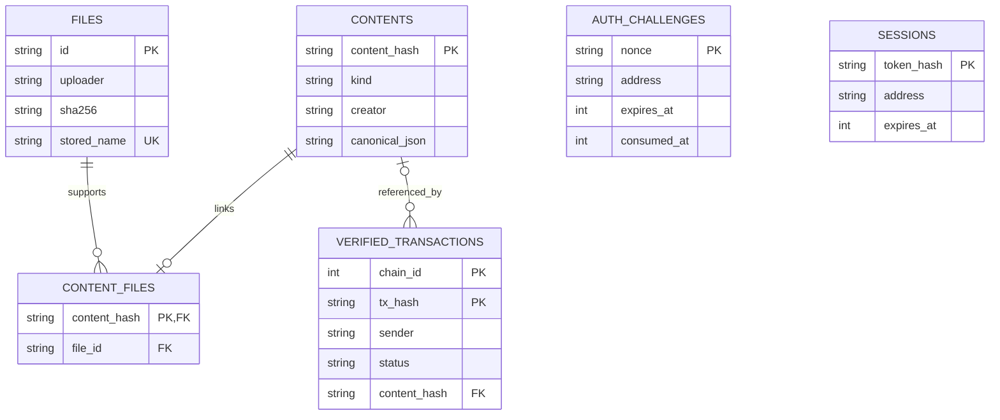

# Data Model

## Data Ownership

| Location | Records | Authority |
|---|---|---|
| RoleRegistry | Immutable Admin and optional legacy labels | Authoritative Admin identity for review decisions. |
| CertificateRegistry | Applications, reserved batch keys, immutable quantities, certificates and retirement | Authoritative lifecycle and ownership. |
| CertificateMarket | Listings, seller credits and cumulative sales | Authoritative price and payment accounting. |
| SQLite | Login state, file metadata, immutable content and verified transaction references | Supporting application data. |
| Persistent filesystem | Uploaded evidence | Original file bytes referenced by SHA-256. |

Do not store editable role, price or ownership copies as independent database truth. Read contract values for business decisions. SQLite uses standard Python `sqlite3`, foreign keys and short transactions.

## Tables

### auth_challenges

| Column | Type | Constraint |
|---|---|---|
| nonce | TEXT | Primary key; random unique challenge. |
| address | TEXT | Validated lowercase address. |
| message | TEXT | Exact message presented for signing. |
| issued_at | INTEGER | UTC epoch seconds. |
| expires_at | INTEGER | UTC epoch seconds. |
| consumed_at | INTEGER | Nullable; set atomically after verification. |

### sessions

| Column | Type | Constraint |
|---|---|---|
| token_hash | TEXT | Primary key; raw token is not stored. |
| address | TEXT | Authenticated lowercase address. |
| csrf_token | TEXT | Random per-session token. |
| created_at | INTEGER | UTC epoch seconds. |
| expires_at | INTEGER | UTC epoch seconds. |

### files

| Column | Type | Constraint |
|---|---|---|
| id | TEXT | Primary key; random public identifier. |
| uploader | TEXT | Lowercase Producer address. |
| original_name | TEXT | Display name only. |
| stored_name | TEXT | Unique server-generated filename. |
| sha256 | TEXT | Digest of original bytes. |
| media_type | TEXT | Validated PDF, PNG or JPEG MIME type. |
| size | INTEGER | Positive byte count, no more than 5 MiB. |
| created_at | INTEGER | UTC epoch seconds. |

### contents

| Column | Type | Constraint |
|---|---|---|
| content_hash | TEXT | Primary key; keccak256 of canonical JSON. |
| kind | TEXT | application, rejection or retirement. |
| creator | TEXT | Lowercase wallet address. |
| chain_id | INTEGER | Configured chain. |
| target_contract | TEXT | Lowercase registry address. |
| canonical_json | TEXT | Immutable exact serialised content. |
| created_at | INTEGER | UTC epoch seconds. |

### content_files

| Column | Type | Constraint |
|---|---|---|
| content_hash | TEXT | Primary key; foreign key to contents. |
| file_id | TEXT | Foreign key to files. |

Each application content object links to one evidence file. The same generation report may support several separately identified batches, but each application's evidence must support its declared quantity. The contract does not permit the same batch key twice.

### verified_transactions

| Column | Type | Constraint |
|---|---|---|
| chain_id | INTEGER | Composite primary key with tx_hash. |
| tx_hash | TEXT | Composite primary key with chain_id. |
| sender | TEXT | Lowercase transaction sender. |
| target | TEXT | Validated deployed contract address. |
| method | TEXT | Decoded allowed contract method. |
| entity_type | TEXT | Nullable application or certificate reference. |
| entity_id | TEXT | Nullable uint256 as decimal string. |
| status | TEXT | pending, confirmed or failed. |
| value_wei | TEXT | Nonnegative decimal string. |
| gas_used | TEXT | Nullable until a receipt is available. |
| block_number | TEXT | Nullable decimal string. |
| block_hash | TEXT | Nullable bytes32 hash. |
| content_hash | TEXT | Nullable foreign key to contents; set only after successful content verification. |
| verified_at | INTEGER | UTC epoch seconds. |

Use TEXT for uint256 values because SQLite integers cannot hold the full range. Validate decimal strings in application code; do not use text ordering to compare monetary values.

Create indexes for `files(uploader)`, `contents(creator, kind)`, `sessions(expires_at)` and `verified_transactions(sender, verified_at, tx_hash)`.

## Relationships

Wallet addresses identify participants without a separate user table. Challenge and session records do not carry database role assignments.

## Storage Operations

For an upload, write to a temporary file, validate its bytes and size, calculate SHA-256, then atomically rename it to its final generated name. Insert its database record in a short transaction. If insertion fails, remove only the new file created by that operation.

Content insertion is immutable and idempotent by hash. Preserve unreferenced content in this version; an interrupted browser or failed receipt verification does not prove that the content is unused on-chain. Never delete metadata merely because a transaction reference has not been recorded locally.

Use parameterised SQL. Enable foreign keys on each connection. Create the initial schema without dropping existing tables and record the schema version. Later structural changes require explicit migrations.

## Persistence and Demonstration Data

Store the database and evidence directory on the hosting platform's persistent disk. An ephemeral application filesystem is insufficient. Back up SQLite with its backup API and preserve evidence files and deployment configuration alongside it. Backups must not contain wallet private keys.

Use fictional sites, organisations and generation reports. Create example application, listing, purchase and retirement states through actual testnet transactions. Do not fabricate contract states in SQLite to populate a demonstration.
