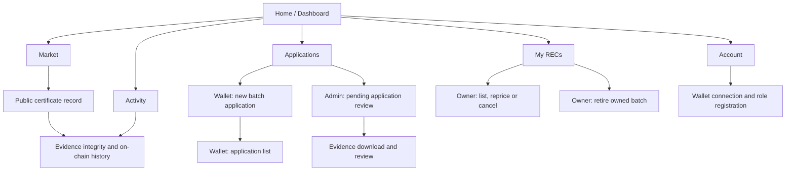

# Responsive Web Interface

GreenCert is a responsive website, not a native Android or iOS application. The shared header provides the wallet button and Sepolia label. A bottom navigation bar links Home, Market, Applications, My RECs, Activity and Account. Cards appear in one column on narrow screens and two columns where there is room. Buttons and navigation links have touch-sized targets.

## Pages

| Route | Main content |
|---|---|
| `/` or `/dashboard` | Workflow explanation, issued/listed/sold/retired counts, source quantity chart and certificate status chart. |
| `/market` | Active listings with source, complete batch quantity and total test ETH price. |
| `/certificates/{id}` | Public site, quantity, owner, status, price, retirement statement and on-chain events. |
| `/applications` | Signed-in wallet application form and list, or Admin review queue and evidence access. |
| `/my-certificates` | Owned batches with listing, repricing, cancellation or retirement controls. |
| `/activity` | Wallet transactions saved after receipt verification. |
| `/account` | Role registration, wallet balance, sale proceeds and withdrawal. |

## Navigation map

The shared navigation links to Home, Market, Applications, My RECs, Activity and Account. The content shown on Applications and My RECs depends on the connected wallet's on-chain role and certificate ownership.

## User flow

Any wallet connects MetaMask and signs the session challenge before using the application form. The form asks for site code and name, source, two-letter country code, a completed generation period, batch index, quantity from 1 to 100 and a PDF, PNG or JPEG evidence file up to 5 MiB. One quantity unit represents one simulated REC and 1 MWh. The browser uploads evidence, requests canonical metadata, checks its hash and submits the application transaction. The Admin opens the application list, downloads evidence and approves or rejects with a reason.

When a browser does not expose MetaMask, the page offers MetaMask's official deep link for the current route and a copy-link fallback. The wallet badge reads `Wallet: Sepolia` only after `eth_chainId` matches the configured chain. A mismatched network blocks wallet connection and contract write actions until the user switches to Sepolia.

An approved batch appears in My Certificates. Its owner can list all units at one total price, change or cancel that listing, or retire it while it is unlisted. Market cards display the complete quantity and price. Any wallet other than the seller can confirm the exact-price purchase transaction. The seller's proceeds remain claimable until Withdraw is clicked. The public certificate page continues to show the owner, fixed quantity and retired status.

Wallet actions display the current stage: account and network check, transaction preparation, MetaMask approval, submission, receipt confirmation and server-side event verification. The initiating control is disabled while a wallet request is active. A submitted hash is recorded before its receipt is available; a confirmation timeout leaves it pending and does not resend the transaction. Empty states explain when there are no applications, listings, certificates or transactions. If deployment configuration is missing, contract-derived data is unavailable until the addresses, blocks and RPC URL are supplied.

## Dashboard charts

The source chart uses horizontal bars for Solar, Wind, Hydro and Unknown. Values are labeled in MWh; one REC equals 1 MWh in this simulation. Zero-value sources are omitted. The status chart shows the number of Active and Retired certificate batches. Both charts use visible text labels as well as bar lengths, so the value is still readable without colour. With no issued certificates they show an empty message. Before contract deployment they show a configuration message instead of sample figures. At wider viewports the two charts sit side by side; on narrow viewports they stack vertically.
