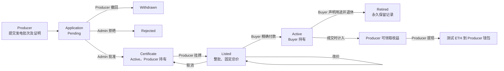
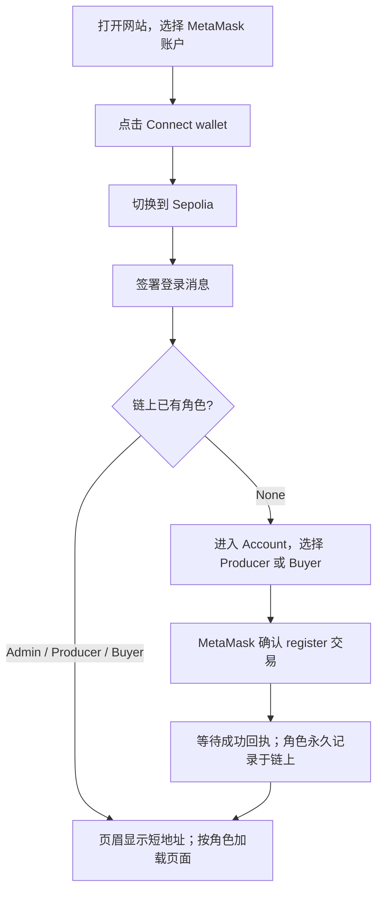
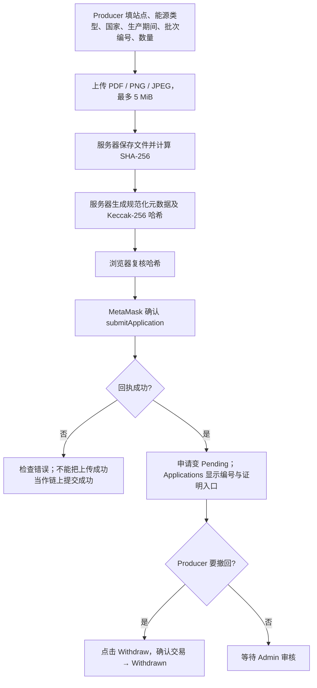
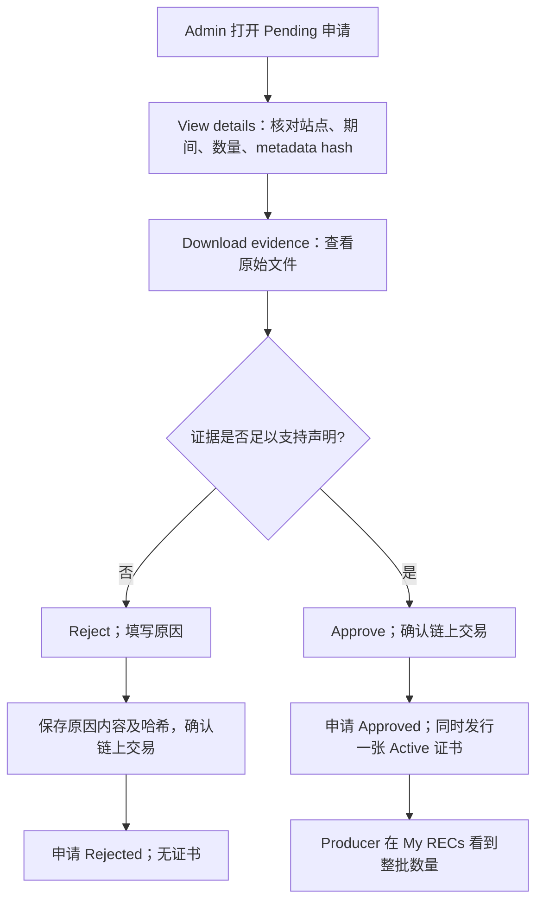
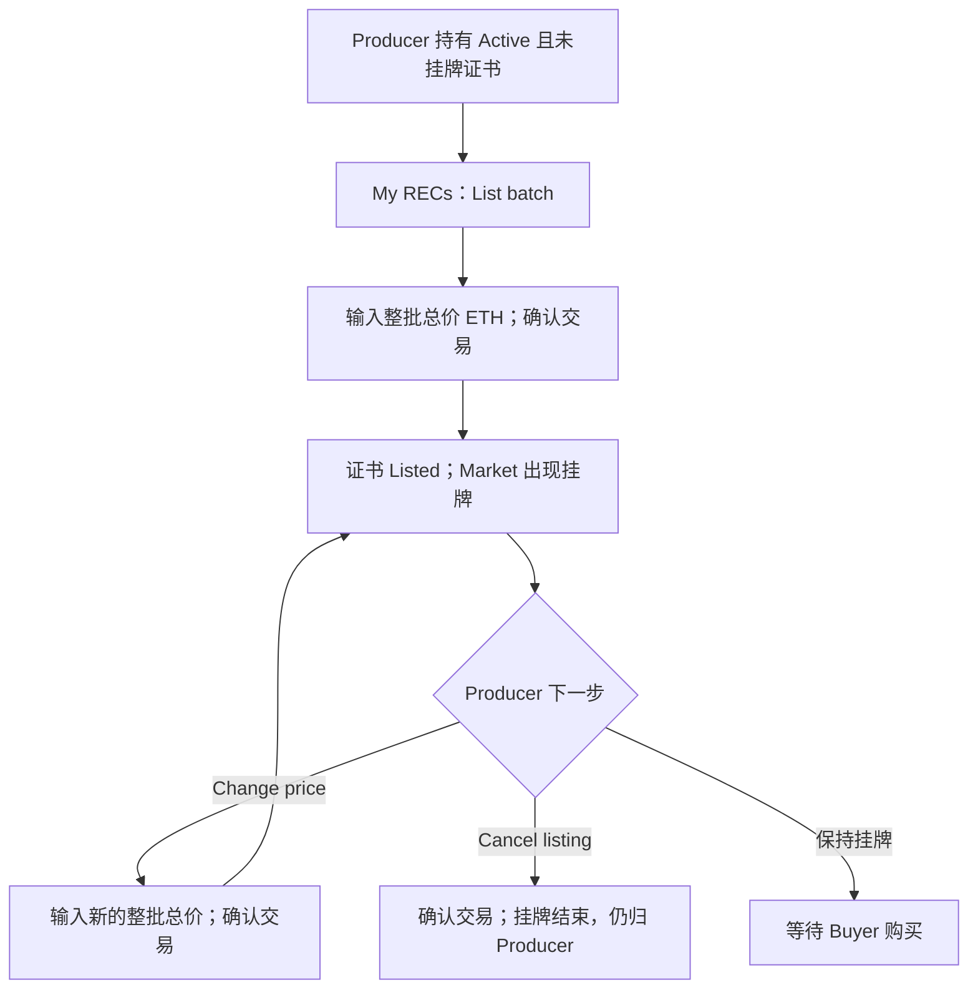
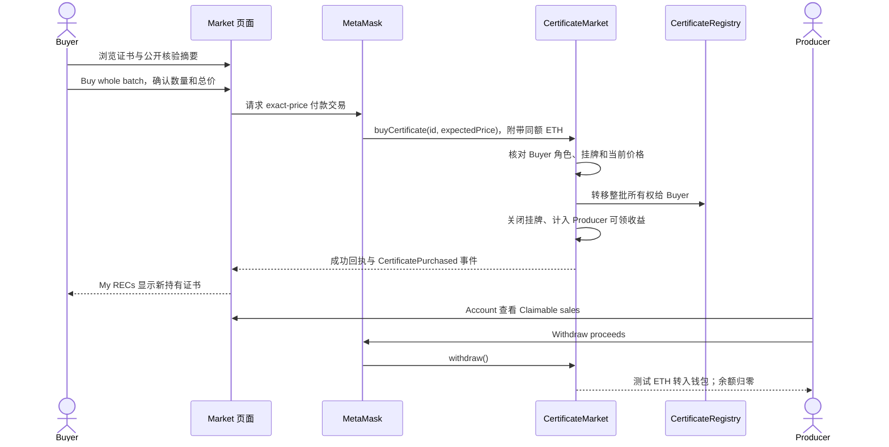
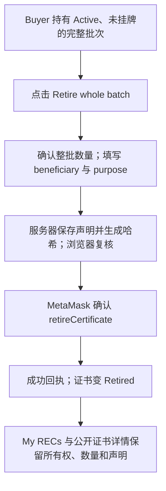
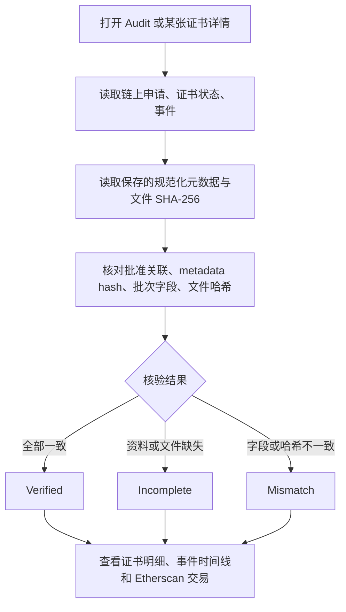
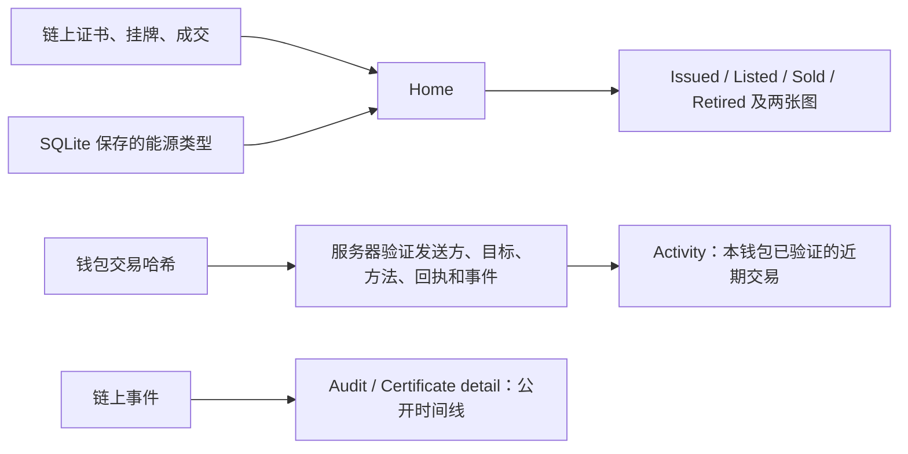

# GreenCert：角色、模块流程与展示讲稿

> 本指南依据当前网页、Flask API、三个 Solidity 合约及现有 Sepolia 部署编写。GreenCert 是使用测试 ETH 的模拟 REC 系统；每个批次整体交易，1 REC 在本项目中对应 1 MWh。流程图可直接复制到支持 Mermaid 的 Markdown 或幻灯片工具。

## 1. 三个角色与完整业务主线

| 角色 | 主要职责 | 可写入的关键状态 | 不能做的事 |
| --- | --- | --- | --- |
| Producer（生产者） | 提交发电批次和证明文件，管理自己的挂牌，领取售款 | 申请 Pending / Withdrawn；挂牌 Listed / 改价 / 取消；领取销售收益 | 审批申请、购买批次、退休证书 |
| Admin（管理员） | 查看申请原始证明、核对声明并批准或拒绝 | Pending → Approved 或 Rejected；批准时发行证书 | 自行注册为 Admin、替别人转移所有权、撤销退休 |
| Buyer（买家） | 查看公开信息、购买整批证书、声明退休用途 | Active 且 Listed → Buyer 持有；Active → Retired | 下载原始证明、审批申请、拆分购买、再次出售 |

未连接钱包的访客也能看 Home、Market、证书详情和 Audit。Admin 在部署 `RoleRegistry` 时指定；Producer 与 Buyer 在 Account 注册一次，角色不可改。所有写操作由 MetaMask 签名并消耗 Sepolia 测试 ETH；连接钱包及签名登录消息本身不消耗 gas。

**注意：**这里的 `Listed` 是 Active 证书的挂牌标志，不是另一种证书状态。撤回或拒绝的批次标识会继续被占用，不能拿同一标识重新提交。购买和退休都是整批操作，不支持拆分、二级转售或撤销退休。

## 2. 模块一：钱包、登录与角色（Account）

**入口：**页眉钱包按钮、底部 `Account`。**合约：**`RoleRegistry`。**后台：**签名挑战及 8 小时会话。

**怎么操作：**先在 MetaMask 选对账户，再点击页眉按钮。检查网络标签是 `Sepolia Testnet`，签署登录消息。未注册的测试账户在 Account 点击对应角色的注册按钮并确认交易。Admin 不经过这个注册界面。刷新页面后，会话可在同一钱包及网络下恢复；换钱包或网络应重新确认登录状态。

**展示成功依据：**页眉出现钱包短地址；Account 显示完整地址和余额；角色对应的操作出现。签署登录消息只证明钱包控制权，角色以 `RoleRegistry.roleOf` 为准。

## 3. 模块二：证明上传与申请（Applications，Producer）

**入口：**`Applications` → `New batch application`。**合约：**`CertificateRegistry.submitApplication`。**存储：**原始文件在服务器磁盘，文件资料和规范化 JSON 在 SQLite；链上只保存哈希和批次字段。

**表单用法：**`Site code` 可用如 `SOLAR-01` 的站点编号；`Site name` 是展示名称；能源类型为 Solar、Wind 或 Hydro；国家代码如 `SG`。日期输入 `YYYY-MM-DD`，生产期必须已经结束。`Batch index` 为正整数；`Quantity` 为 1–100，表示本批 REC 数量，也对应模拟 MWh。选取 PDF、PNG 或 JPEG 文件后按 `Upload and submit`，再确认 MetaMask 交易。要演示撤回，须在 Admin 审核之前点击该 Pending 申请的 `Withdraw`。

**展示成功依据：**新申请显示 `Pending`，详情包含站点、期间、数量和 metadata hash；交易出现在 Activity。若用户取消钱包弹窗，或交易失败，申请不会变为 Pending。相同链、Producer、站点、期间和批次编号形成唯一批次标识；已撤回或拒绝也不能重复使用。

## 4. 模块三：管理员审核与发行（Applications，Admin）

**入口：**Admin 钱包登录后进入 `Applications`。**合约：**`CertificateRegistry.approveApplication` / `rejectApplication`。

**怎么操作：**切换到 Admin 钱包并登录，进入 Applications。先按 `View details` 查看申请字段，再通过 `Download evidence` 检查文件。证据不能支持数量或内容有疑点时点 `Reject`，输入理由并确认交易；可信时点 `Approve`。只可处理 Pending 申请，且一个批准申请只发行一张证书。

**展示成功依据：**申请从 Pending 变成 Approved 或 Rejected。批准后，Market 的 `All issued certificates` 和 Producer 的 `My RECs` 能看到新证书；证书初始状态 Active、Owner 为 Producer、数量固定。拒绝后没有新证书。审核是人工判断，不应说系统已经独立验证了实际发电。

## 5. 模块四：挂牌、改价与取消（My RECs / Market，Producer）

**入口：**Producer 钱包进入 `My RECs`；公开市场在 `Market`。**合约：**`CertificateMarket`，由它调用 `CertificateRegistry` 更新挂牌标志。

**怎么操作：**在 My RECs 找到自己持有的 Active 证书，点 `List batch`，输入**整批总价**，不是每张 REC 单价。成交前可用 `Change price` 改价，或用 `Cancel listing` 取消。Market 展示批次总数量和总价；取消后不会改变所有权。

**展示成功依据：**挂牌后 Market 出现该批，证书的 Listed 标志为真；改价后页面总价改变；取消后从可售列表移除。只有持有该证书的 Producer 能做这些操作，不能给已退休或已售给 Buyer 的证书挂牌。

## 6. 模块五：购买与售款领取（Market / Account）

**Buyer 的入口：**`Market` → `Buy whole batch`。**Producer 的入口：**`Account` → `Withdraw proceeds`。**合约：**`CertificateMarket.buyCertificate` / `withdraw`。

**怎么操作：**Buyer 登录后在 Market 查看站点、数量、整批总价；可先点击证书详情检查 Evidence integrity 和历史。按 `Buy whole batch`，确认浏览器提示的数量、总价，再在 MetaMask 确认支付。必须有总价加 gas 的测试 ETH。如果卖家在确认期间改价，旧价交易会失败，需要刷新再确认。成交后切换 Producer，打开 Account 看到 `Claimable sales`，点击 `Withdraw proceeds` 并确认交易。

**展示成功依据：**Market 中该挂牌消失，证书 Owner 变 Buyer，Buyer 的 My RECs 出现该证书；Producer 的可领收益增加，提现后变 0。购买时所有权转移、取消挂牌和收益记账为一个链上原子操作；提现是另一笔交易。

## 7. 模块六：退休声明（My RECs，Buyer）

**入口：**Buyer 的 `My RECs` → `Retire whole batch`。**合约：**`CertificateRegistry.retireCertificate`。

**怎么操作：**Buyer 在 My RECs 找到购买后的 Active 证书，点击退休按钮，确认数量，输入受益对象 `beneficiary` 和用途 `purpose`，最后确认 MetaMask 交易。当前版本一次退休整个批次，不能部分退休，也没有撤销操作。

**展示成功依据：**状态由 Active 变 Retired；持有人仍是 Buyer；公开证书详情可见受益对象和用途，时间线有 `CertificateRetired`。退休后证书不再可交易。

## 8. 模块七：公开核验与审计（Certificate detail / Audit）

**入口：**底部 `Audit`；或从 Market、Home、Activity 进入。任何访客无需钱包也可查看。**数据源：**链上申请、证书和事件 + SQLite 元数据 + 本地证据文件哈希。

**怎么操作：**Audit 页先看 Verified / Incomplete / Mismatch 统计，再用下拉框筛选，点击批次进入详情。详情显示站点、数量、状态、Owner、Evidence integrity 四项检查及 On-chain history。时间线的 `View transaction` 会跳到 Sepolia Etherscan。Buyer 与访客可看**核验摘要**，不可下载原始证明；只有上传文件的 Producer 和 Admin 可下载。

**展示时必须讲清：**Verified 表示当前可用文件、数据库内容和链上哈希相符，**不等于**第三方证明发电真实发生。RPC 不可用时事件状态为 unavailable，不能将其说成“无事件”。

## 9. 模块八：总览与交易记录（Home / Activity）

**Home 怎么看：**Issued 是已发行批次数，Listed 是当前挂牌数，Sold 是累计成交数，Retired 是已退休数；能源图按 REC/MWh 汇总，状态图按 Active/Retired 批次数汇总。挂牌中的证书仍是 Active。

**Activity 怎么看：**登录钱包后查看由服务器核验并保存的近期交易哈希、状态与 gas；它是当前钱包的交易记录，并非全链事件全集。公开的证书事件应在 Audit 或证书详情查看。

## 10. Present 时怎么讲、怎么点

建议 **8–10 分钟**，先讲完整业务闭环，再展示失败/分支操作。页面英文，口述可以用下面的英文短句；讲解与答疑可用中文。

| 时间 | 页面或材料 | 操作与要说的话 | 必须指出的结果 |
| --- | --- | --- | --- |
| 0:00–0:45 | Home | “GreenCert tracks a simulated REC batch from evidence submission to retirement on Sepolia.” 解释 1 REC = 1 MWh，整批交易。 | 四个总数和图表是链上状态的总览。 |
| 0:45–1:30 | 一张主流程图 | 介绍 Producer、Admin、Buyer 三个角色及三个合约。 | Flask/SQLite 保存证明和元数据，链上保存角色、状态、所有权和价格。 |
| 1:30–3:00 | Producer 的 Applications | 展示申请表、上传文件、Pending 申请的 View details。 | 文件仅在服务器，哈希与批次字段上链。 |
| 3:00–4:00 | Admin 的 Applications | 展示管理员如何下载证明、选择 Approve 或 Reject。 | 已批准 #1 发行了证书；#2 Withdrawn、#3 Rejected 展示其他分支。 |
| 4:00–5:15 | Producer 的 My RECs / Market | 讲解挂牌、改价、取消和整批总价。 | 成交前可调整，成交后所有权转移。 |
| 5:15–6:30 | Buyer 的 Market / My RECs | 讲精确付款、购买、Buyer 持有和退休声明。 | 证书 #1 当前为 Retired、Owner 是 Buyer。 |
| 6:30–7:30 | Producer Account | 展示 Claimable sales / Withdraw proceeds，说明成交与提现是两笔交易。 | 既能保证付款与转移同时成功，也避免直接向卖家推送付款。 |
| 7:30–8:45 | Audit → Certificate #1 → Etherscan | “The public audit checks consistency between evidence, metadata and on-chain records.” 点开 Verified、事件和交易链接。 | 当前 #1 的 4 项检查均通过，公开时间线有 7 条事件。 |
| 8:45–10:00 | 测试结果 / 局限 | 介绍合约、前后端和真实 Sepolia 验证，以及人工审核的边界。 | 不能把哈希一致说成真实发电认证。 |

### 现场操作前准备

1. 启动 Flask，检查 Sepolia RPC、`deployment.json` 和 MetaMask 网络。三个账户分别标记 Admin、Producer、Buyer；每个写交易账户要有测试 ETH 支付 gas，Buyer 还需支付整批价格。
2. 先演练无交易的历史展示：Applications 中有 Approved、Withdrawn、Rejected；证书 #1 为 Retired；Audit 显示 Verified 和事件时间线。当前 Sepolia 核查结果为 **3 个申请、1 张已退休证书、1 次成交、7 条证书事件**。这个状态没有活跃挂牌，因此 Market 的可售列表为空是正常的。
3. 若教师要求**现场新交易**，提前备好新的证明文件、已经结束的期间，以及**从未使用过的**站点/批次组合；先提交申请并由 Admin 批准，才能获得一张可挂牌的新证书。不要试图重新操作已退休的 #1。
4. 为现场交易准备交易哈希和静态截图作为备用。每笔交易都要等 MetaMask 回执，再刷新页面核对申请状态、Owner、挂牌、收益或退休状态。不要把“钱包弹出确认”当作成功结果。
5. 不要展示私钥、`.sepolia-test.env`、RPC 凭据或浏览器开发工具中的敏感会话资料。公开合约地址与交易哈希可以展示。

### 容易被问到的五个问题

- **为什么需要区块链？**角色权限、申请/证书状态、所有权、价格和生命周期事件由共享的 Sepolia 合约记录；任一参与者不能只改网页数据库来更改这些链上事实。
- **为什么还要 SQLite 和文件存储？**PDF/图片不适合直接放链上；服务器保存原件与可读元数据，链上哈希提供一致性锚点。SQLite 不决定所有权或价格。
- **如何防止同批重复申请？**合约对链、Producer、站点哈希、期间和批次编号计算并保留批次 key；这只能阻止完全相同标识的重复提交，无法自动识别伪造资料或跨系统重复。
- **Verified 是否等于绿色认证？**不是。它证明记录和文件哈希一致；真实发电量仍需 Admin 人工审核，项目不提供法定认证或自动计量证明。
- **买家能否只买几张，或退休后再出售？**不能。本版本只支持整批购买和整批永久退休，没有拆分、二级转售或恢复功能。

## 11. 代码核对依据

业务规则和合约操作见 `docs/development/01-product.md`、`docs/development/03-contracts.md` 及 `contracts/`；页面入口见 `templates/`；按钮与钱包交易见 `static/js/pages.js`、`static/js/wallet.js`、`static/js/transactions.js`；公开审计与文件权限见 `backend/routes/api_records.py`、`backend/routes/api_files.py`；真实链上步骤见 `tests/manual/sepolia-checklist.md`。
